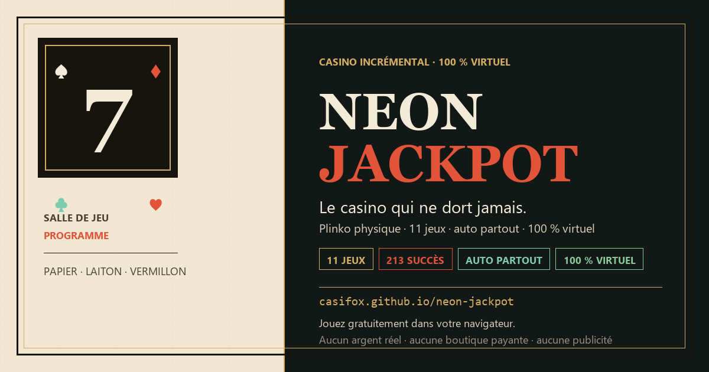
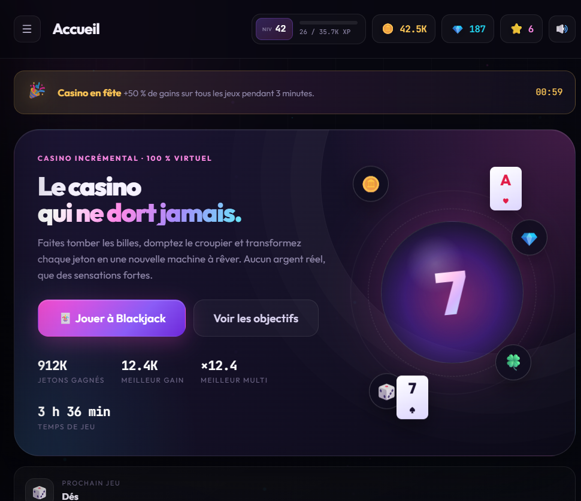
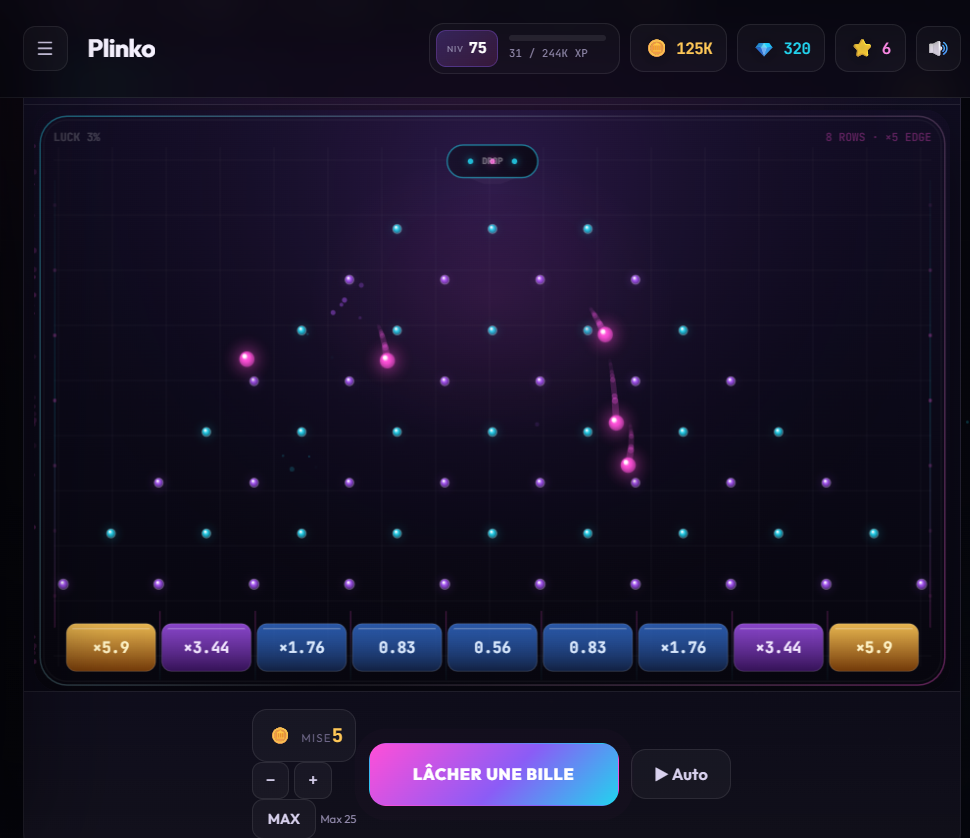

# 🎰 Neon Jackpot

**Le casino incrémental qui ne dort jamais.** Un jeu 100 % virtuel, jouable directement dans le navigateur : Plinko physique, Blackjack, Roulette, Machines à sous, Mines, Crash, Dés, Keno, Poker vidéo, Courses de chevaux… et une salle des coffres secrète.

[🎮 Jouer en ligne](https://casifox.github.io/neon-jackpot/) · [🐛 Signaler un bug](https://github.com/Casifox/neon-jackpot/issues) · [⭐ Code source](https://github.com/Casifox/neon-jackpot)



## 📸 Aperçu

| Accueil | Plinko physique |
| --- | --- |
|  |  |

> **Aucun argent réel.** Toutes les monnaies sont virtuelles. Aucun lien avec de vrais paris, aucune boutique payante, aucune publicité.

## 🔧 Dernières corrections (v1.5.1)

- **Auto-achat global** : l'auto-achat quitte le Plinko et achète maintenant l'amélioration la moins chère de tous les jeux débloqués, avec un budget de 15 % du solde.
- **Manches en arrière-plan** : Plinko rattrape les billes tombées pendant une absence, Crash encaisse au seuil prévu, la Roulette termine son tour et les Chevaux terminent leur course au retour sur l'onglet.
- **Jackpot et free spins** : le jackpot tombe sur n'importe quelle ligne de 5 symboles identiques (jokers inclus) et contribue à 1,5 % ; les free spins restent à 5 tours ×1,5 avec scatters 2× / 4× / 8×.
- **Tournoi équestre** : bouton **⏭ Accélérer** pendant chaque course et attente entre les manches réduite à 1,2 s.
- **Contenu secret** : nouvelle page **Le Croupier** (niveau 750), audiences quotidiennes, récompenses et succès dédiés.
- **Couche 4** : quatre défis de l'infini réclamables au niveau 1000, avec bonus de gains permanents et gemmes.
- **Corrections** : couleurs HSL du Plinko, console propre (ResizeObserver filtré), modales et libellés.

## 🔧 Corrections précédentes (v1.4.1)

- **Équilibrage des machines à sous** : le retour de ligne est normalisé (environ 92 % sur 3 rouleaux, 82 % hors free spins sur 5 rouleaux) au lieu d'un RTP de 40 % au début et 123 % en fin de progression.
- **Auto sécurisé** : les automatisations ne reprennent plus toutes seules après un rechargement.
- **Mines** : l'assistant ne révèle plus qu'une seule case sûre par manche, puis l'auto redevient risqué.
- **Succès** : pagination par 60 cartes pour alléger la page mobile.
- **Poker** : distinction claire entre gain net et simple retour de mise.
- **Statistiques** : libellés corrigés, compteur de Crash réparé.
- **UI** : fin des modales superposées, meilleure lisibilité mobile, upgrades Auto rendus utiles (vitesse, séquences 25/50).

---

## ✨ Ce qui rend Neon Jackpot différent

- **Physique réelle au Plinko.** Les billes ont une vraie gravité, rebondissent sur chaque picot, perdent de l'énergie et sont guidées magnétiquement vers leur case. Traînées lumineuses, impacts, étincelles, cases qui s'illuminent.
- **11 jeux, pas un de moins.** Plinko, Blackjack, Roulette, Machines à sous, Mines, Crash, Dés, Keno, Poker vidéo, Courses de chevaux et la Salle des coffres.
- **Auto partout.** Chaque jeu possède un bouton **Auto** qui le fait tourner tout seul : Plinko, Blackjack, Roulette, Slots, Mines, Crash, Dés, Keno, Poker, Courses et même les coffres.
- **Plus de 200 succès** (213 exactement) avec gemmes et bonus permanents.
- **Quêtes quotidiennes et hebdomadaires**, événements aléatoires, Heure dorée, Visiteur mystérieux.
- **Collections** : billes, cartes, jetons, tables, avatars et écurie. Packs à ouvrir avec des gemmes.
- **Synergies entre jeux** : une série au Blackjack booste le Plinko, un jackpot de slots offre une bille arc-en-ciel, etc.
- **Prestige à couches** : Étoiles, Couronnes, Diamants, puis boucle infinie.
- **Sauvegarde locale automatique** + export/import JSON et gains hors-ligne.
- **Animations généreuses** : particules, confettis, secousses, textes flottants, transitions, sons synthétisés en WebAudio.
- **Mode confort** : réduction des animations, qualité des particules, volume, rappel de pause.

## 🕹️ Comment jouer

1. **Commencez au Plinko.** Lâchez une bille, améliorez vos rangées et visez les bords.
2. **Chaque mise donne de l'XP.** Les niveaux débloquent les jeux suivants.
3. **Utilisez l'Auto** quand vous voulez regarder le casino tourner : chaque écran de jeu possède son propre bouton.
4. **Collectionnez** succès, quêtes, objets et synergies pour augmenter vos gains permanents.
5. **Renaissance** au niveau 40 : repartez plus fort avec des Étoiles.

### Déblocages principaux

| Niveau | Déblocage |
| ---: | --- |
| 1 | Plinko |
| 10 | Blackjack |
| 20 | Roulette |
| 25 | Gemmes & boutique |
| 30 | Machines à sous |
| 40 | Premier Rebirth |
| 60 | Mines |
| 75 | Crash |
| 90 | Dés |
| 100 | Keno |
| 150 | Rebirth 2 |
| 200 | Poker vidéo |
| 300 | Courses de chevaux |
| 400 | Synergies |
| 500 | Rebirth 3 |
| 750 | Jeu secret |
| 1000 | Prestige infini |

## 🚀 Lancer le jeu

### En local, sans dépendance

```bash
# depuis le dossier du projet
python -m http.server 8080
# puis ouvrir http://localhost:8080
```

Le jeu fonctionne aussi en double-cliquant sur `index.html` : les données sont pré-compilées dans `src/data/bundle.js`.

### Données d'équilibrage

Tous les réglages (coûts, multiplicateurs, déblocages, quêtes, collections, succès, synergies) sont dans :

```text
src/data/*.json
```

Après une modification :

```bash
npm run build:data
```

## 🧱 Structure

```text
index.html                 Interface et chargement des scripts
src/css/                   Styles, composants, jeux et animations
src/js/                    Moteur, état, XP, succès, quêtes, UI
src/js/games/              Plinko, Blackjack, Roulette, etc.
src/data/                  JSON d'équilibrage + bundle généré
tools/build-data.js        Compilation des JSON vers bundle.js
assets/                    Logo, aperçu social
```

## 🛠️ Technologies

- HTML / CSS / JavaScript vanilla (aucun framework, aucun build obligatoire)
- Canvas 2D pour le Plinko physique et la roue de roulette
- WebAudio pour les sons synthétisés
- `localStorage` pour la sauvegarde
- GitHub Pages pour l'hébergement

## 📄 Licence

MIT — voir [LICENSE](LICENSE). Fait avec ❤️ et beaucoup de néons.

## ⚠️ Disclaimer

Neon Jackpot est un jeu de divertissement. Toutes les monnaies, mises et récompenses sont fictives. Aucun argent réel n'est utilisé, gagné ou perdu. Aucun mécanisme de pari réel n'est proposé.
